# SiPinjam

Aplikasi peminjaman alat laboratorium berbasis React Native (Expo) dengan pemindaian QR Code, didukung REST API Express dan MySQL.

**Tugas Akhir Praktikum Pemrograman Perangkat Bergerak 2026**  
Ade Raihan · NIM 2112012414011

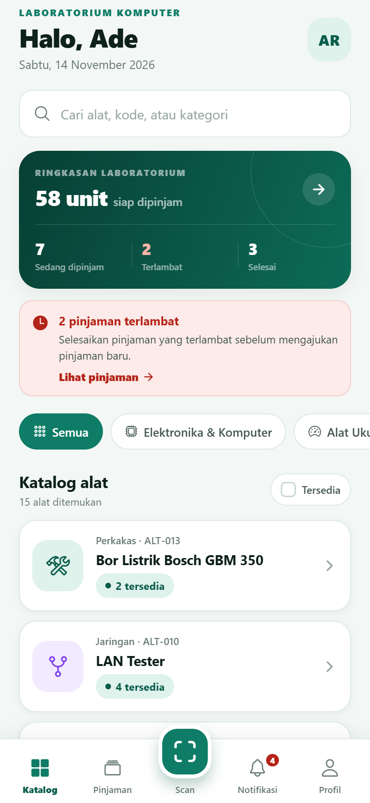

## Daftar isi

- [Fitur](#fitur)
- [Akun demo](#akun-demo)
- [Arsitektur](#arsitektur)
- [Menjalankan proyek](#menjalankan-proyek)
- [Aturan bisnis](#aturan-bisnis)
- [API](#api)
- [Database](#database)
- [Pengujian](#pengujian)
- [Build APK](#build-apk)
- [Deploy API](#deploy-api)
- [Tangkapan layar](#tangkapan-layar)
- [Struktur folder](#struktur-folder)

## Fitur

- **Katalog alat** dengan pencarian, filter kategori, dan filter stok tersedia. Stok dihitung dari pinjaman aktif, bukan angka statis.
- **Detail alat** berisi kondisi, stok, deskripsi, dan QR alat.
- **Pengajuan pinjaman** dengan jumlah unit, durasi 1–3 hari, dan catatan. Maksimal 3 jenis alat per transaksi.
- **QR Code** untuk alat (`SIPINJAM:TOOL:ALT-001`) dan pinjaman (`SIPINJAM:LOAN:PJM-261114-001`). QR dibaca lewat kamera atau dimasukkan manual.
- **Daftar pinjaman** dengan filter berjalan, terlambat, dan selesai; lengkap dengan status dan denda.
- **Detail pinjaman** berisi QR, daftar alat, linimasa, rincian denda, dan tombol pengembalian.
- **Notifikasi** pengingat H-1, jatuh tempo, keterlambatan, dan pengembalian. Tanpa cron: baris notifikasi memiliki `show_at` dan hanya ditampilkan setelah waktunya tiba.
- **Profil dan halaman Tentang** berisi ringkasan aktivitas, aturan, teknologi, dan info pembuat.
- **Denda otomatis** Rp2.000 per hari keterlambatan, dihitung server saat pengembalian.
- **Blokir pinjaman baru** bila pengguna masih memiliki pinjaman terlambat.

## Akun demo

| Akun | Email | Kata sandi | Isi |
| --- | --- | --- | --- |
| Demo | `demo@sipinjam.id` | `sipinjam123` | 10 pinjaman: 7 berjalan, 2 terlambat, 3 selesai |
| Uji bersih | `uji@sipinjam.id` | `sipinjam123` | Belum punya pinjaman |

Akun demo sengaja memiliki **2 pinjaman terlambat** untuk memperagakan denda dan aturan blokir. Untuk mencoba alur pinjam dari nol tanpa mengembalikan pinjaman lama, masuk dengan akun uji.

## Arsitektur

```
Expo App (React Native)
   │  axios + Bearer JWT
   ▼
Express REST API (/api/v1)
   │  mysql2 pool + transaksi
   ▼
MySQL / MariaDB
```

- Aplikasi: React Native 0.88, Expo SDK 58, React Navigation 7, `expo-camera`, `react-native-qrcode-svg`, `date-fns`.
- Backend: Express 4, mysql2, JWT (7 hari), bcryptjs, zod.
- Database: MySQL 8 / MariaDB 10.4+, InnoDB, utf8mb4.

## Menjalankan proyek

### Prasyarat

- Node.js 18+ (diuji di Node 24)
- MySQL 8 / MariaDB (XAMPP juga cukup)
- Expo Go di ponsel, atau emulator Android
- HP dan komputer berada di jaringan yang sama (untuk Expo Go)

### 1. Database

Nyalakan MySQL, lalu dari folder `backend`:

```bash
npm install
cp .env.example .env      # Windows: copy .env.example .env
npm run db:init
```

`db:init` membaca `database/schema.sql` dan `database/seed.sql`. **Skrip ini menghapus tabel lama** dan membuat ulang data demo.

### 2. Backend

```bash
cd backend
npm run dev
```

API berjalan di `http://localhost:5000`. Cek `http://localhost:5000/health`.

### 3. Aplikasi

```bash
cd app
npm install
npx expo start
```

Buka QR Expo Go di ponsel. Alamat API diturunkan otomatis dari host Metro (`http://<IP-komputer>:5000/api/v1`), jadi tidak perlu mengubah IP manual saat jaringan berubah.

Bila backend berada di alamat lain:

```bash
# PowerShell
$env:EXPO_PUBLIC_API_URL="http://192.168.1.10:5000/api/v1"; npx expo start -c
```

atau isi `expo.extra.apiUrl` di `app/app.json`, lalu jalankan `npx expo start -c`.

> Android emulator memakai `10.0.2.2`, bukan `localhost`. Fallback ini sudah ditangani otomatis bila `hostUri` tidak tersedia.

### Perintah singkat dari root

```bash
npm run install:all   # install backend + app
npm run db:init       # buat ulang database & seed
npm run backend       # jalankan API (watch mode)
npm run app           # jalankan Expo
npm test              # unit test backend
```

## Aturan bisnis

| Aturan | Nilai |
| --- | --- |
| Durasi pinjam | 1–3 hari kalender, dihitung dari tanggal pinjam |
| Maksimal jenis alat per transaksi | 3 |
| Denda | Rp2.000 per hari keterlambatan per pinjaman |
| Status tersimpan | `dipinjam`, `dikembalikan` |
| Status tampilan | `dipinjam`, `terlambat`, `dikembalikan` |
| Keterlambatan | Dihitung date-only: `tanggal_kembali_rencana < hari ini` |
| Alat sama | Tidak boleh muncul di dua pinjaman aktif milik pengguna yang sama |
| Pinjaman terlambat | Pengguna diblokir dari pinjaman baru sampai semuanya dikembalikan |
| Stok | `stok_total - SUM(loan_items.jumlah)` dari pinjaman berstatus `dipinjam` |
| Notifikasi | Tanpa cron; dibuat saat pinjaman dibuat dan saat notifikasi dibuka |

## API

Base URL: `http://localhost:5000/api/v1`  
Autentikasi: `Authorization: Bearer <token>`  
Envelope sukses: `{ "data": ... }`; daftar menambahkan `meta`. Error: `{ "error": { "code", "message" } }`.

| Method | Endpoint | Keterangan |
| --- | --- | --- |
| POST | `/auth/login` | Login email + kata sandi |
| GET | `/auth/me` | Profil pengguna dari token |
| GET | `/categories` | Daftar kategori + jumlah alat |
| GET | `/tools` | Katalog; query `search`, `category_id`, `tersedia`, `limit`, `offset` |
| GET | `/tools/:id` | Detail alat |
| GET | `/tools/kode/:kode` | Cari alat dari kode/QR |
| POST | `/loans` | Buat pinjaman |
| GET | `/loans` | Daftar pinjaman; `status=berjalan\|aktif\|terlambat\|selesai\|semua` |
| GET | `/loans/:id` | Detail pinjaman |
| GET | `/loans/kode/:kode` | Cari pinjaman dari kode/QR |
| POST | `/loans/:id/return` | Kembalikan alat |
| GET | `/notifications` | Notifikasi yang sudah waktunya tampil |
| PATCH | `/notifications/:id/read` | Tandai satu dibaca |
| PATCH | `/notifications/read-all` | Tandai semua dibaca |
| GET | `/stats/summary` | Ringkasan pinjaman, denda, alat, notifikasi |
| GET | `/stats/populer` | Alat paling sering dipinjam |
| GET | `/health` | Health check + koneksi database |

Contoh:

```bash
curl -X POST http://localhost:5000/api/v1/auth/login \
  -H "Content-Type: application/json" \
  -d "{\"email\":\"demo@sipinjam.id\",\"password\":\"sipinjam123\"}"

curl http://localhost:5000/api/v1/tools?search=laptop \
  -H "Authorization: Bearer <token>"

curl -X POST http://localhost:5000/api/v1/loans \
  -H "Authorization: Bearer <token>" \
  -H "Content-Type: application/json" \
  -d "{\"items\":[{\"tool_id\":1,\"jumlah\":1}],\"durasi_hari\":2,\"catatan\":\"Praktikum\"}"
```

Dokumentasi lengkap: [`docs/API.md`](docs/API.md). Koleksi Postman: [`docs/postman_collection.json`](docs/postman_collection.json).

### Kode error

`VALIDATION_ERROR`, `UNAUTHORIZED`, `FORBIDDEN`, `NOT_FOUND`, `CONFLICT`, `STOK_TIDAK_CUKUP`, `SUDAH_DIPINJAM`, `PINJAMAN_TERLAMBAT`, `SUDAH_DIKEMBALIKAN`, `INVALID_CODE`, `DATABASE_UNAVAILABLE`, `INTERNAL_ERROR`.

## Database

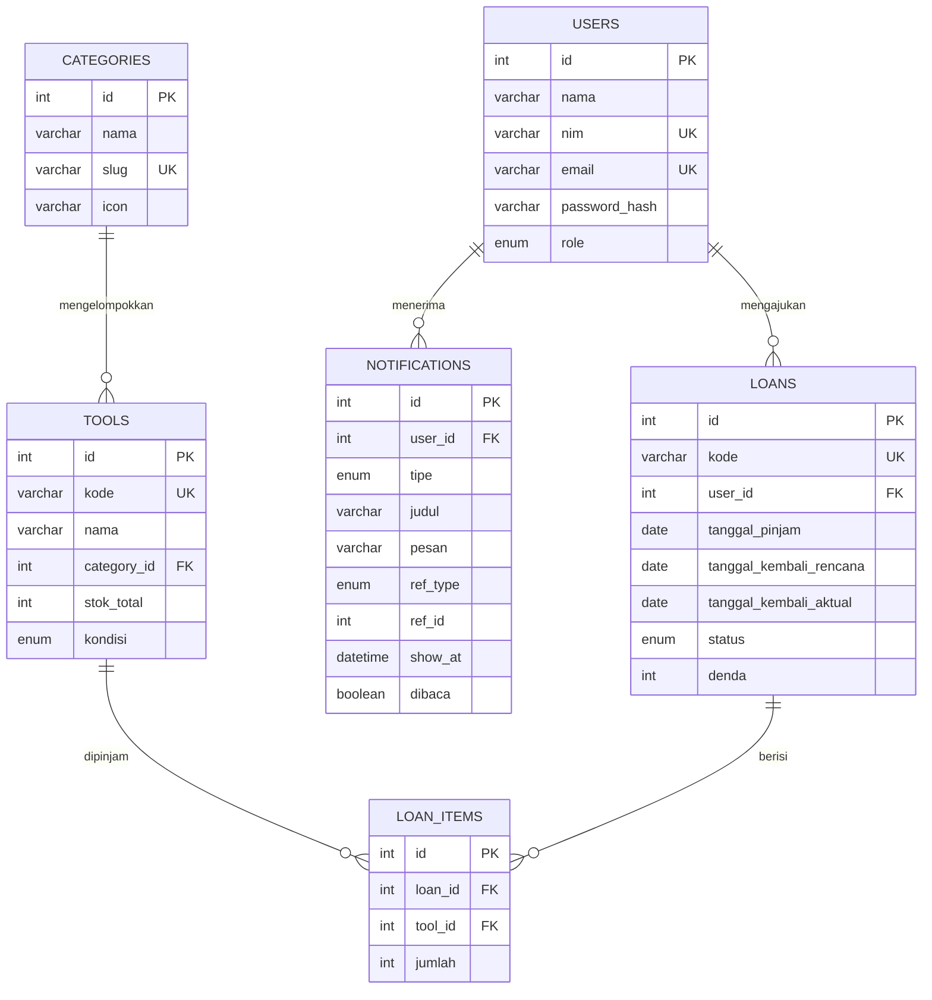

Seed berisi 4 kategori, 15 alat, 2 akun, 10 pinjaman lintas status, dan 8 notifikasi. Semua tanggal dibuat relatif terhadap `CURDATE()` agar status keterlambatan tetap relevan kapan pun seed dijalankan.

## Pengujian

```bash
cd backend
npm test
```

Unit test mencakup perhitungan tanggal WIB, denda, status pinjaman, pembentukan kode, dan parser QR. Selain itu sudah diverifikasi secara manual:

- Login, katalog, pencarian, detail alat, dan stok real-time.
- Buat pinjaman, blokir stok kurang, blokir alat ganda, dan blokir pinjaman terlambat.
- Pengembalian tepat waktu dan terlambat (denda Rp2.000/hari).
- Filter pinjaman, notifikasi, tandai dibaca, dan statistik.
- `npx expo export --platform android` berhasil (Metro, 2.287 modul).
- Tangkapan layar 390×844 dari render web; kamera hanya aktif di perangkat Android/iOS.

Checklist responsi dan pemetaan syarat tugas akhir ada di [`docs/PANDUAN-TA.md`](docs/PANDUAN-TA.md).

## Build APK

`app/eas.json` sudah menyiapkan profil `preview` dengan `buildType: apk`.

1. Ganti `EXPO_PUBLIC_API_URL` di `app/eas.json` dengan URL API hasil deploy.
2. Login dan build:

```bash
cd app
npx eas-cli login
npx eas-cli build --platform android --profile preview
```

3. Unduh APK dari tautan EAS, lalu uji di perangkat. Untuk demo di jaringan lokal, isi `EXPO_PUBLIC_API_URL` dengan `http://<IP-komputer>:5000/api/v1` dan pastikan firewall mengizinkan port 5000.

## Deploy API

Blueprint Render tersedia di [`render.yaml`](render.yaml). Ringkasan:

1. Buat database MySQL di Aiven/Railway, pilih database tersebut, lalu impor `database/schema.sql` dan `database/seed.sql` (keduanya tidak membuat database).
2. Deploy repository ke Render dengan root directory `backend`.
3. Isi environment: `DB_HOST`, `DB_PORT`, `DB_USER`, `DB_PASSWORD`, `DB_NAME`, `DB_SSL=true`, `JWT_SECRET` (acak panjang), `CORS_ORIGIN=*`.
4. Verifikasi `https://<service>.onrender.com/health`.
5. Set `EXPO_PUBLIC_API_URL` di `app/eas.json` ke `https://<service>.onrender.com/api/v1`.
6. Render free tier tidur saat idle; pasang UptimeRobot untuk ping `/health` tiap 5 menit.

## Tangkapan layar

| Login | Katalog | Detail alat |
| --- | --- | --- |
| 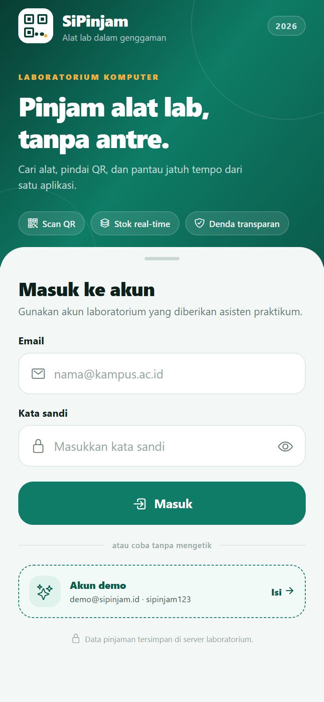 |  | 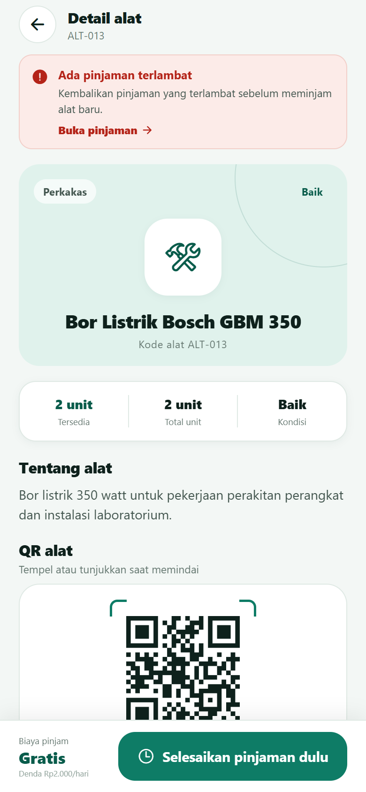 |

| Pinjaman | Detail pinjaman | Konfirmasi kembali |
| --- | --- | --- |
| 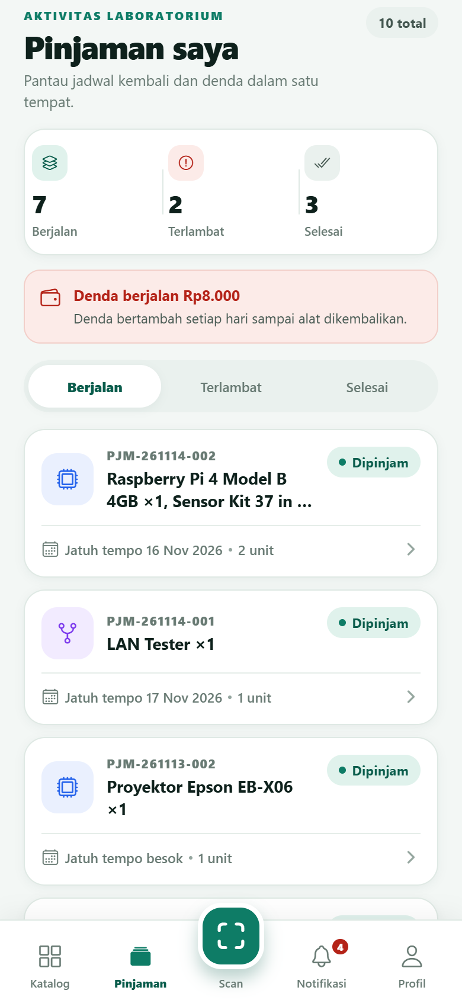 | 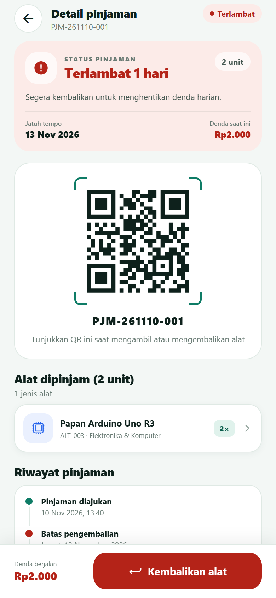 | 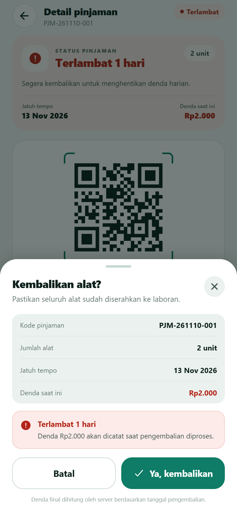 |

| Notifikasi | Scan QR | Hasil scan |
| --- | --- | --- |
| 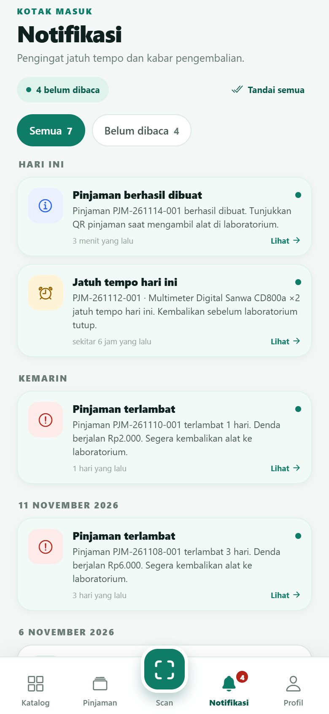 | 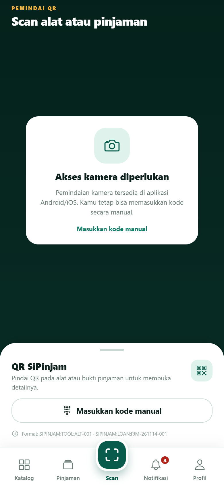 | 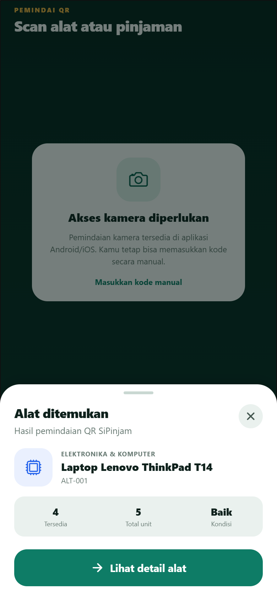 |

| Profil | Tentang | Form pinjam |
| --- | --- | --- |
| 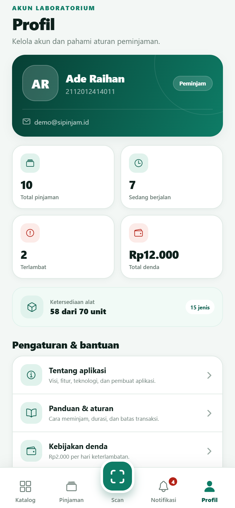 | 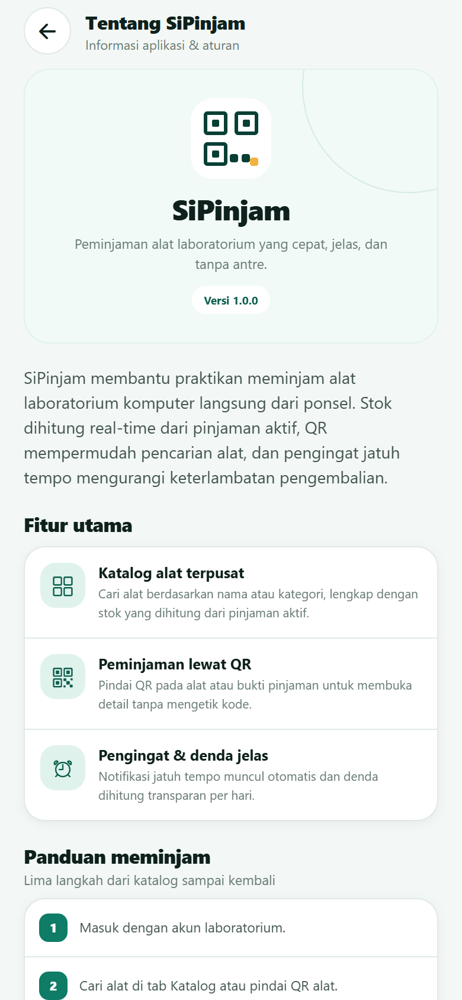 | 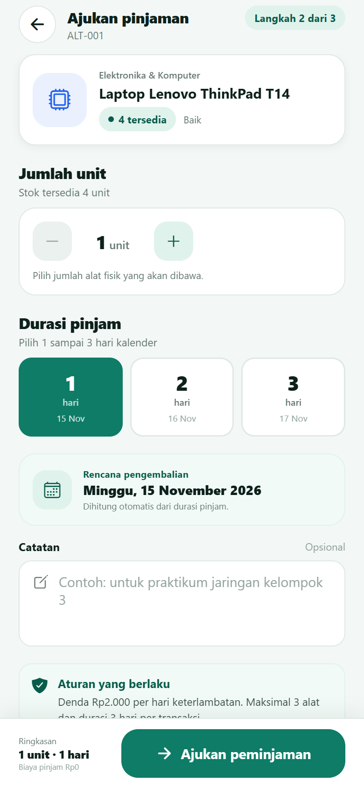 |

| Sukses | Detail aktif | Setelah kembali |
| --- | --- | --- |
| 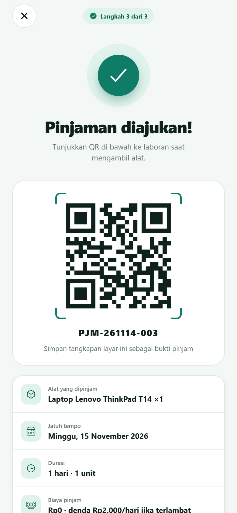 | 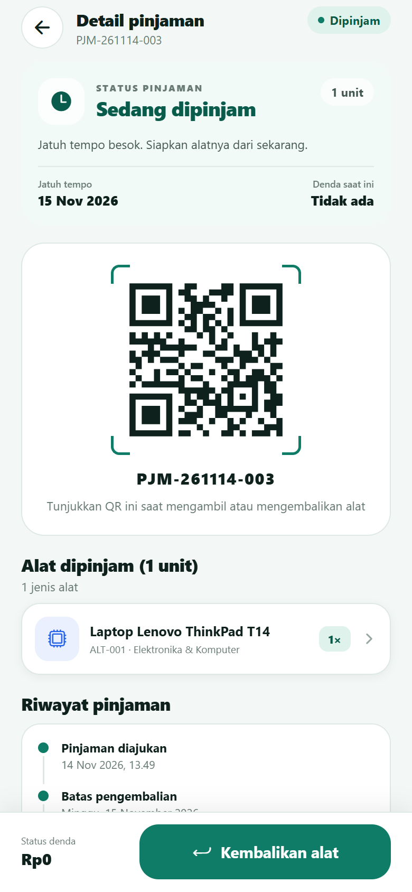 | 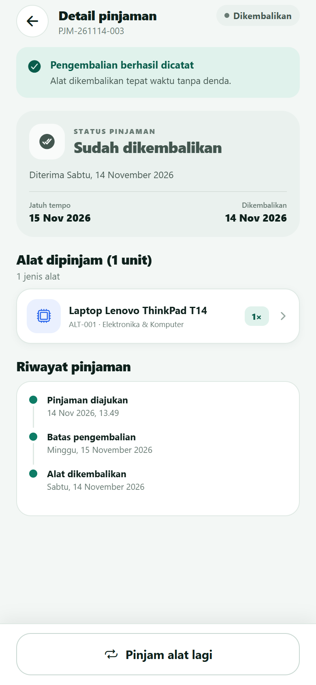 |

## Struktur folder

```
SiPinjam/
├── app/                     # Expo / React Native
│   ├── src/
│   │   ├── components/      # komponen UI
│   │   ├── context/         # Auth & Notification
│   │   ├── hooks/           # useResource, debounce, focus reload
│   │   ├── navigation/      # root stack, tabs, custom tab bar
│   │   ├── screens/         # 11 layar
│   │   ├── services/        # axios client
│   │   ├── theme/           # token warna, tipografi, bayangan
│   │   └── utils/           # format tanggal/rupiah, parser QR
│   ├── assets/              # ikon & splash
│   └── eas.json             # profil build APK
├── backend/
│   ├── src/
│   │   ├── routes/          # auth, categories, tools, loans, notifications, stats
│   │   ├── middleware/      # auth JWT, error handler
│   │   └── lib/             # tanggal, denda, serializer, validasi
│   ├── scripts/init-db.js   # schema + seed
│   └── test/                # unit test node:test
├── database/                # schema.sql, seed.sql
├── docs/                    # API, Postman, panduan TA, screenshot
└── render.yaml
```

## Catatan

- Aplikasi ini fokus pada peran **peminjam**. Tabel `users` sudah mengenal peran `admin`, tetapi layar admin berada di luar cakupan P0/P1.
- Notifikasi bersifat in-app, bukan push notification.
- Denda belum terhubung ke pembayaran; pencatatan dilakukan di data pinjaman.
- Data demo hanya untuk pembelajaran. Jangan gunakan kata sandi demo di produksi.
